### Şükrü Çağrı Öztürk

Founder of [SCO](https://sco.tr/en), an AI company based in Ankara.

SCO builds its own AI models and installs them inside companies: wired into their ERP, documents and tools, running on their own servers or private cloud. Company data never has to leave the company. [How a deployment works](https://sco.tr/en/how-it-works)

#### Under the SCO umbrella

- **[SCO Messenger](https://messenger.sco.tr)**: team messaging with work cards, on iOS, Android, web and desktop.
- **[SCON](https://sco.tr/en/scon)**: the SCON One device puts content on screens, managed from one app.
- **[inavo](https://sco.tr/en/inavo)**: websites, mobile apps and brands, since 2014.
- **[SAVARON](https://sco.tr/en/savaron)**: software, e-commerce and brand identity, now part of SCO.

[sco.tr](https://sco.tr/en) &nbsp;·&nbsp; [LinkedIn](https://www.linkedin.com/in/sukrucagriozturk/)
